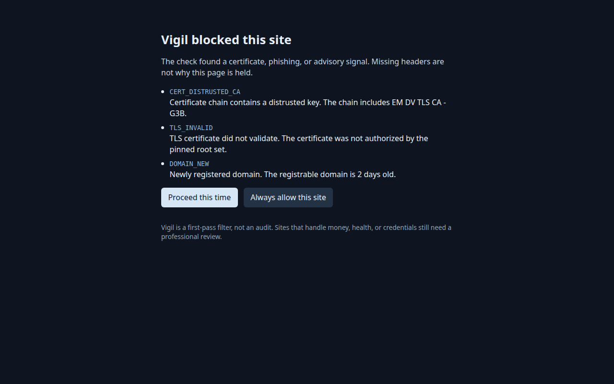
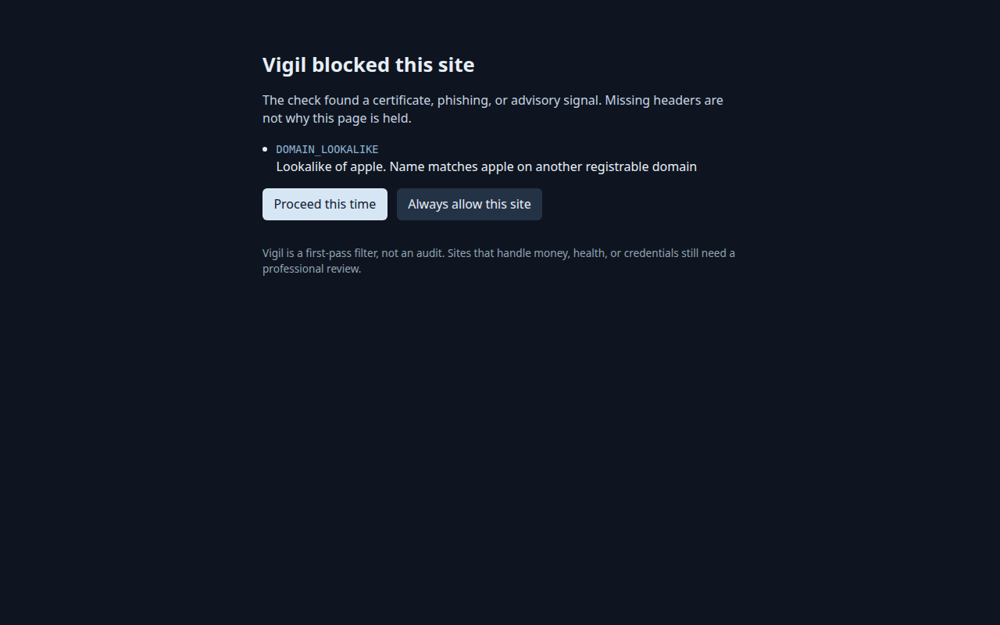
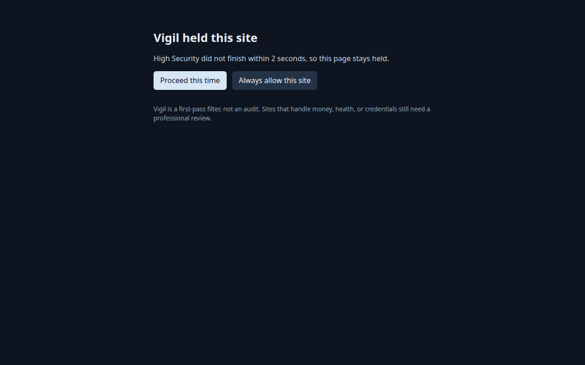
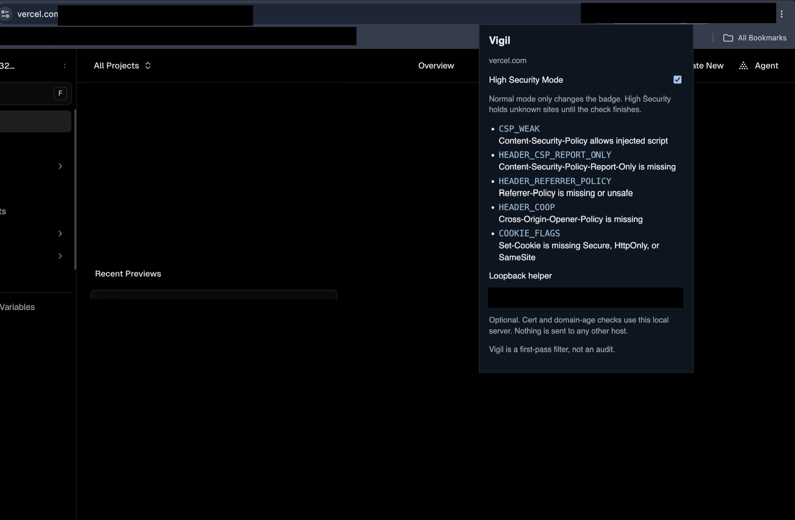

# Vigil

<p>
  
  
</p>
<p>
  
  
</p>

Vigil is an early first-pass check for certificates, lookalike sites, and a few known advisories. It is not an audit, not antivirus, and not a store release. A green result means the checks below did not fire. It does not mean the site, the server, or the account is safe.

The Chrome extension and the command-line helper run today. The macOS Safari container has built with Xcode 27.1 when code signing is turned off for the compile. iOS, including Safari on iPhone, is an upcoming release and is not in this tree. See [Safari](#safari).

## What Vigil catches

- A certificate that chains through a block-listed key. The bundled list includes the eight compromised eMudhra intermediates and emSign ECC Root CA - G3. Record-only parent roots are not blanket-distrusted.
- An expired certificate, a name that does not match the host, a self-signed leaf, or a TLS chain the pinned Mozilla roots reject.
- Lookalike and homoglyph names, mixed-script labels, and a login form on a domain younger than seven days.
- A page that discloses a PHP version below 8.2.35, 8.3.36, 8.4.27, or 8.5.12. The owner's scan blocks. A visitor scan warns. The finding says to upgrade PHP. `session.upload_progress.enabled=0` is only a partial mitigation.
- An exact LiteLLM 1.107.0 pin in a lockfile or Dockerfile.
- On `vigil doctor`: a local Node below 22.23.4, 24.22.1, or 26.12.1 on that release line, an affected curl or Go, a local kernel in the PwnEscape range, and a trust store that still contains a distrusted eMudhra key. Doctor does not block a deploy.

Missing security headers and the shared-host kernel note stay in the popup. They do not hold the page in High Security Mode.

Reputation lookups stay off and send no host. Certificate Transparency queries run only with `--ct`, and only for the registrable domain.

## Vigil doesn't fix everything

When a server itself is compromised, its certificate can still pass Vigil's checks. A valid certificate does not mean a safe site. Watch for breach disclosures from the operator. Change passwords and keys that were stored there. Turn on two-factor authentication and passkeys. Treat an unexpected reset, verify, or payment email as phishing, and do not follow links or instructions inside it.

These are the same kind of gap. Vigil does not close them:

- **Server-side breaches and patches.** Railway's 21 October 2026 environment-variable disclosure, and Vercel's April 2026 bulletin (closed 16 October 2026), live in a platform dashboard. A clean source tree does not show or rotate those secrets. Vigil also does not patch PHP, GitLab, nginx, or OpenSSL on a server, and it does not see a QUIC or HTTP/3 stack. The helper speaks HTTP/1.1. A visitor warning is not a patch. A PHP page that hides its version is only a suspicion.
- **Device-code phishing.** A real identity-provider page can ask for a device code and approve a session for someone else. The certificate is valid. Vigil does not see that approval. Do not enter a device code you did not start.
- **ClickFix.** A page can tell a person to paste a command into a terminal or the Run dialog. Vigil does not run page script, and it does not stop that paste. A credential form that appears only after JavaScript or a CAPTCHA is not visible to the fetch.
- **Chrome Certificate Transparency.** Vigil counts embedded SCT bytes. It does not check SCT signatures, log operators, or Chrome's per-root cutoffs, and it does not copy every Chrome root-store removal that another store still trusts. The distrust file is a snapshot. Vigil does not consume CRLSet, OneCRL, or CRLite. After Oct 27, 2026, re-check the emSign ECC Root CA - G3 removal before changing that file. See `docs/TODO.md`.
- **Live reputation feeds.** Safe Browsing, PhishTank, and similar lookups stay off. A static brand table misses a kit on the real domain and a kit on an aged or hijacked tenant.

A page and a certificate also do not show the host kernel behind a site. `KERNEL_SHARED_HOST` says that, and it does not claim the remote machine is vulnerable.

## Layout

| Path | Role |
|---|---|
| `packages/core` | Rules, report schema 2.0, SSRF policy, taxonomy |
| `packages/intel` | Distrusted CAs, brand and homoglyph tables, advisory JSON |
| `packages/netcheck` | Pinned Mozilla TLS, RDAP age, OSV, URL composition |
| `apps/cli` | `vigil scan`, `check-url`, `deps`, `doctor`, `serve`, `native-host` |
| `apps/extension` | Chrome MV3 extension. High Security Mode holds unknown sites. Not a store release. |
| `apps/safari` | macOS Safari container for the same extension. iOS is an upcoming release and is not included. Placeholder team id. Not an App Store release. |
| `fixtures/` | Vulnerable, clean, phishing, lockfile, and toolchain samples |
| `docs/TAXONOMY.md` | How findings map to the eleven domains, NIST CSF 2.0, and CIS Controls v8.1 |
| `docs/agent-skill-vuln-watch.md` | A routine someone can give their own agent for public vulnerability announcements |

Rule ids, domains, and framework mappings live in `packages/core/data/rule-catalog.json`. Reports always include `summary.byDomain` for all eleven domains.

Bundle ids are `com.example.vigil.*`. The committed Apple team id is the placeholder `XXXXXXXXXX`. The Chrome extension's `key` is a public SubjectPublicKeyInfo used to keep the unpacked extension id stable. The private key is not in this repository. None of these identifiers are tied to a personal Apple team.

## Commands

```text
vigil scan <path|url> [--json] [--prompt [text]] [--hosting vercel|netlify|cloudflare]
                      [--allow-host name] [--sample] [--ct]
vigil check-url <url>
vigil deps [path]
vigil doctor [path]
vigil serve [--port 8787]
vigil native-host
vigil install-native-host --extension-id <id>
vigil uninstall-native-host
```

`scan` of a URL is the site owner. `check-url` is a visitor. `deps` exits 2 on an exact LiteLLM 1.107.0 pin. `doctor` reads the running Node (`process.version`), local curl, Go, `uname -r`, and the ca-certificates, certifi, and Node trust stores. It exits 0 even when it reports a finding. Node should be 22.23.4 or newer on the 22 line, 24.22.1 or newer on the 24 line, or 26.12.1 or newer on the 26 line. Go's eMudhra filter is 1.27.3 or newer, or 1.26.10 on the 1.26 line.

Exit 0 means the command finished and `block_deploy` is false. Exit 2 means `block_deploy`. Exit 1 is usage, SSRF, or a network failure. A critical finding blocks only when `recommendationOnly` is false.

## Dev

Node must satisfy `package.json` `engines`: `>=22.23.4 <23`, `>=24.22.1 <25`, or `>=26.12.1`.

```text
pnpm install
pnpm check
pnpm vigil scan fixtures/vulnerable
```

`pnpm check` lints, typechecks, bundles the CLI, and runs the tests. Tests do not use the live network. The bundle copies the Mozilla CA file next to `apps/cli/dist/vigil.js`.

## Chrome extension

`pnpm build` writes an unpacked extension to `apps/extension/dist`. Load that folder from `chrome://extensions` with Developer mode on. It is not published to the Chrome Web Store.

Normal mode only updates the toolbar badge. High Security Mode sends an unknown site to the extension hold page before page script runs, runs the check, and continues when the result is not a certificate failure, a fake-site signal, or a confirmed advisory. Missing security headers and notes such as `KERNEL_SHARED_HOST` stay in the popup. The 2 second limit starts when the navigation starts. A check that runs past it stays held, with **Proceed this time** and **Always allow this site**.

Certificate and domain-age checks run in `vigil native-host`, which Chrome launches through native messaging. That is the default path. `vigil serve` on `127.0.0.1:8787` is the fallback: it prints a token once, and the popup must have that token. A configured helper that fails keeps the page held. With no helper configured, High Security uses the local hostname check. The stable unpacked extension id is `hldpadjbahmnkhfchiikihdofpelfjne`. From the repo root, after `pnpm build` and loading `apps/extension/dist`:

```text
pnpm vigil install-native-host --extension-id hldpadjbahmnkhfchiikihdofpelfjne
```

Quit Chrome and open it again. The helper field can stay blank. See `docs/EXTENSION.md` for the host paths and the red-team checklist.

## Safari

`pnpm build` copies the same background, hold page, and popup into `apps/safari/Shared (Extension)/Resources`, with the Safari manifest. Open `apps/safari/Vigil.xcodeproj` on a Mac after that build. The committed team id is `XXXXXXXXXX`. The bundle ids in this tree are `com.example.vigil.macos` and `com.example.vigil.macos.extension`. Set the team in Xcode and leave that change uncommitted.

On Safari, the certificate check runs in the app through `runtime.sendNativeMessage`. `vigil serve` on `127.0.0.1:8787` is the fallback when that call fails. Build and test steps are in `docs/SAFARI-TESTING.md`. This is a local Xcode run. It is not an App Store or TestFlight release.

The macOS scheme **Vigil macOS** has built with Xcode 27.1 and `CODE_SIGNING_ALLOWED=NO`. Linux cannot run `xcodebuild`, so this repository's checks do not claim a Safari build.

iOS, including Safari on iPhone, is coming soon. This release does not include an iOS app, an iOS extension, or an iOS scheme.
