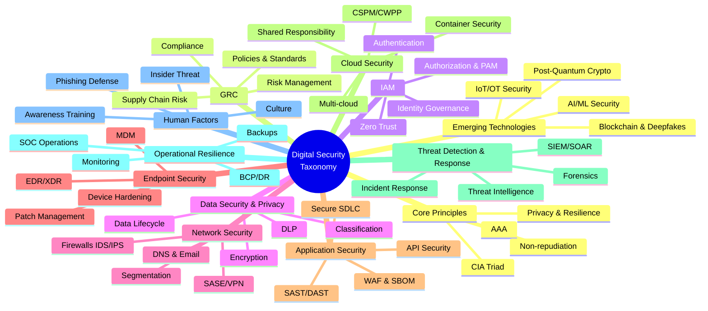

# Digital Security Taxonomy chat (Grok share)

## You
Would you build for me a list of digital security taxonomy then build me a visualized digital security taxonomy guide?

## Grok

**Digital Security Taxonomy Guide**

This is a practical, multi-level taxonomy of digital security (cybersecurity / information security). It synthesizes modern industry frameworks and domains, primarily aligned with:

- **NIST Cybersecurity Framework (CSF) 2.0** (Govern, Identify, Protect, Detect, Respond, Recover)
- **CIS Critical Security Controls v8.1**
- **ISO/IEC 27001:2022** (ISMS)
- Common practitioner domains (IAM, Network, Endpoint, AppSec, Cloud, etc.)

It is designed for mapping risks, controls, maturity assessments, gap analysis, and program structure.

### Foundational Principles
- **CIA Triad**: Confidentiality, Integrity, Availability
- **AAA**: Authentication, Authorization, Accounting
- Non-repudiation, Privacy, Resilience, Least Privilege, Defense in Depth, Zero Trust (“Never trust, always verify”)

### Primary Domains (Hierarchical Taxonomy)

**1. Governance, Risk & Compliance (GRC)**
- Risk Management Strategy & Assessment
- Policies, Standards & Procedures
- Compliance & Regulatory (ISO, NIST, GDPR, sector-specific)
- Roles, Responsibilities & Oversight
- Supply Chain / Third-Party Risk Management

**2. Identity & Access Management (IAM)**
- Authentication (MFA, Passwordless, Biometrics)
- Authorization & Access Control (RBAC, ABAC, Least Privilege)
- Identity Lifecycle & Governance (IGA)
- Privileged Access Management (PAM)
- Federation, SSO & Zero Trust Identity

**3. Data Security & Privacy**
- Data Classification & Discovery
- Encryption (at rest, in transit, in use)
- Data Loss Prevention (DLP)
- Privacy Controls & Rights Management
- Data Lifecycle (retention, disposal, minimization)

**4. Network & Infrastructure Security**
- Perimeter Defense & Network Segmentation
- Firewalls, IDS/IPS, NAC
- Zero Trust Network Access (ZTNA) / SASE
- Secure Configuration & Hardening
- DNS, Email & Web Filtering

**5. Endpoint & Device Security**
- Endpoint Detection & Response (EDR/XDR)
- Device Hardening & Secure Configuration
- Mobile Device Management (MDM) / UEM
- Patch & Vulnerability Management
- Anti-Malware & Browser Isolation

**6. Application & Software Security**
- Secure Software Development Lifecycle (SSDLC / DevSecOps)
- Application Security Testing (SAST, DAST, IAST, SCA)
- API Security & Web Application Firewalls (WAF)
- Software Bill of Materials (SBOM) & Dependency Management
- Runtime Application Self-Protection (RASP)

**7. Cloud & Hybrid Security**
- Cloud Security Posture Management (CSPM)
- Cloud Workload Protection (CWPP) / CNAPP
- Cloud Identity & Access (CIEM)
- Data Security in Cloud
- Container, Kubernetes & Serverless Security
- Shared Responsibility Model & Multi-cloud Governance

**8. Threat Intelligence, Detection & Response**
- Threat Intelligence & Threat Hunting
- Security Information & Event Management (SIEM) / SOAR
- Continuous Monitoring & Logging
- Incident Response & Management
- Digital Forensics & Evidence Handling

**9. Operational Security & Resilience**
- Vulnerability & Configuration Management
- Backup, Recovery & Data Resilience
- Business Continuity & Disaster Recovery (BCP/DR)
- Security Operations (SOC)
- Infrastructure Resilience & Testing

**10. Human Factors & Awareness**
- Security Awareness & Skills Training
- Phishing Simulation & Social Engineering Defense
- Insider Threat Programs
- Security Culture & Usable Security

**11. Emerging & Specialized Technologies**
- AI/ML Security & Adversarial Threats
- IoT / OT / ICS Security
- Post-Quantum Cryptography
- Blockchain / Web3 Security
- Deepfakes & Disinformation Defense

### Alignment Notes

| Taxonomy Domain | NIST CSF 2.0 Functions | Typical CIS Controls Focus |
|---|---|---|
| GRC | Govern, Identify | 15 (Service Providers), 18 (Pen Testing) |
| IAM | Protect (PR.AA) | 5–6 (Account & Access) |
| Data Security | Protect (PR.DS) | 3 (Data Protection) |
| Network & Infrastructure | Protect, Detect | 12–13 |
| Endpoint | Protect | 4, 10 |
| Application | Protect | 16 |
| Cloud | Protect, Identify | Multiple (asset, config, access) |
| Detection & Response | Detect, Respond, Recover | 8, 17 |
| Operational Resilience | Recover, Protect | 11 |
| Human Factors | Protect (PR.AT), Govern | 14 |

### Visualized Guides

Hierarchical Mind Map View (main domains + key sub-elements):

Layered Radial / Sunburst-Style Overview (principles → domains → control types → frameworks):

### Interactive Mermaid Mind Map

Copy and paste the following into mermaid.live or any Mermaid-compatible tool (Notion, GitHub, Obsidian, etc.) for an expandable interactive view:

### How to Use This Taxonomy
1. **Risk Mapping** — Tag risks or assets to one or more domains.
2. **Control Inventory** — Map existing controls (tools, processes, policies) to domains and subcategories.
3. **Maturity Assessment** — Score each domain (e.g., Initial → Managed → Optimized).
4. **Gap Analysis & Prioritization** — Identify weak domains and align with NIST CSF or CIS Implementation Groups.
5. **Program Structure** — Use as the skeleton for a security program, RACI, or reporting to leadership.

This taxonomy is intentionally practical and technology-neutral while remaining current with 2024–2026 frameworks. It can be expanded with specific controls, metrics, or tooling per subcategory as needed.

Would you like a downloadable PDF version of this guide, a deeper expansion of any domain, a maturity scoring template, or mappings to specific tools/frameworks?

(180 sources)

---

## You
Where in this taxonomy do the php and node.js vulnerabilities impact today?

## Grok

### Primary location: Application & Software Security (Domain 6)

PHP and Node.js vulnerabilities sit almost entirely inside Application & Software Security. Both are application runtimes / languages used to build and run web apps, APIs, and services, so the vulnerabilities and their direct impact live there.

#### Exact subcategories that are hit

| Subcategory | How PHP / Node.js vulnerabilities show up |
|---|---|
| Secure SDLC / DevSecOps | Insecure coding patterns, missing input validation, unsafe deserialization, prototype pollution (Node), old PHP practices |
| Application Security Testing | SAST finds language-specific issues; DAST/IAST finds runtime exploits; SCA flags vulnerable packages |
| Dependency & SBOM Management | Biggest practical impact today — especially Node.js (npm ecosystem) and PHP (Composer / outdated packages). Most real-world incidents come from transitive dependencies, not core language bugs |
| API Security & WAF | Exploits against PHP/Node endpoints (RCE, injection, auth bypass) are often blocked or mitigated here |
| Runtime Protection | RASP / runtime sensors that catch exploitation attempts against PHP or Node processes |

#### Secondary / downstream impact in other domains

| Domain | Impact type | Example |
|---|---|---|
| Endpoint & Device Security | Compromised application server becomes an endpoint | RCE in Node/PHP leads to reverse shell or malware on the host |
| Data Security & Privacy | Data exposure or exfiltration | SQL injection (classic PHP), NoSQL injection (Node), or file read bugs |
| Detection & Response | Alerting and incident response | SIEM rules for PHP/Node exploit patterns, anomalous process behavior |
| Cloud & Hybrid Security | Workload and container impact | Vulnerable Node/PHP containers or serverless functions (AWS Lambda, etc.) |
| Operational Resilience | Patching and recovery | Emergency patching of runtime or dependencies, rollback, rebuild |

#### Practical takeaway today (2026)
- **Node.js**: The dominant risk is the npm supply chain (dependency confusion, malicious packages, prototype pollution, outdated transitive deps). This is pure Application Security → Dependency & SBOM.
- **PHP**: Still common in legacy and CMS environments (WordPress, Laravel, Magento, etc.). Risks are a mix of outdated runtimes, insecure coding patterns, and Composer dependencies — again centered in Application Security.

**Bottom line:**

PHP and Node.js vulnerabilities are Application & Software Security problems first and foremost (especially the dependency/SBOM subcategory). Everything else is secondary blast radius once an application is successfully exploited.

(80 sources)
